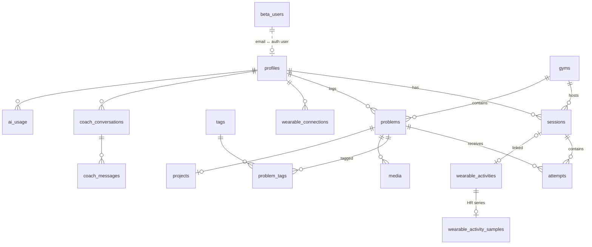

# Data model

All primary keys are UUIDs. Every table holding personal data has RLS scoped to `auth.uid()`. Migrations: `supabase/migrations/20261002000000_leblond_v1.sql`, `20261003000000_fontainebleau_boolder.sql` (lettered Font scale, Boolder catalogue).



| Table | Notes |
|---|---|
| `beta_users` | Whitelist (email, display name, `admin`/`beta_tester`, active). Writes: service role only. |
| `profiles` | Created by trigger on sign-up. Target grade + system, optional body metrics, language, onboarding timestamp. |
| `gyms` | Shared catalogue. Check constraint locks Arkose → `ARKOSE_COLOR`, Climbing District → `CLIMBING_DISTRICT_COLOR`. |
| `favourite_gyms` | Per user. |
| `problems` | Private to creator. Native grade validated per system; optional Font estimate with confidence and source (all-or-nothing check). Trigger: grade system must equal the gym's. |
| `tags`, `problem_tags` | 24 style tags from the brief. |
| `sessions` | One live session per user (partial unique index). `source` defaults to `MANUAL`. |
| `attempts` | The core event. `attempt_number` is per climber per problem across sessions; `FLASH` only allowed on attempt 1 (check constraint). Written through `log_attempt()`; only classification/notes are updatable. |
| `media` | Storage path must start with the owner id. |
| `projects` | One per problem; auto-set to `SENT` on a send. |
| `coach_conversations`, `coach_messages` | Patrick history, private. |
| `ai_usage` | Append-only for users (rate-limit integrity). Tokens, latency, request type — no prompt text. |
| `wearable_connections` | Status + encrypted tokens. Clients can read status columns only. |
| `wearable_activities` | Normalised workouts; unique per (user, provider, provider id) + `dedup_key`. |
| `wearable_activity_samples` | Downsampled HR series kept out of the main row. |
| `outdoor_areas`, `outdoor_circuits`, `outdoor_problems` | Fontainebleau catalogue imported from Boolder (CC BY 4.0). Read: active beta users; write: service role only. Each area owns one `gyms` row (`external_provider = 'BOOLDER'`, unique on `(external_provider, external_id)`). |
| `outdoor_data_imports` | One row per import (source commit, date, counts, skipped). |

`problems.outdoor_problem_id` links a climber's problem to a catalogue problem: unique per climber, must belong to the gym of that area (trigger), set to null if the problem disappears upstream.

Storage buckets: `media` (private, 50 MB, images/videos) and `wearable-files` (private, 4 MB, FIT). Objects live under `<user_id>/…`.

## Training sessions (migration `20261020000000_training_sessions.sql`)

Executable training is separate from the climbing journal:

```
training_plans ─(plan_id, plan_session_index)─┐
calendar_entries ─(calendar_entry_id, unique)─┤
                                              ▼
training_sessions   PLANNED → IN_PROGRESS → COMPLETED  (or SKIPPED / CANCELED / INTERRUPTED)
      │  timers: started_at, paused_at, paused_seconds, completed_at — elapsed time is always derived
      ▼
training_session_exercises   immutable instruction snapshot (jsonb) + targets (sets/reps/seconds/rest)
      ▼
training_exercise_sets       one row per set, unique (exercise_id, set_index) → retries never duplicate
```

- One `IN_PROGRESS` session per climber (partial unique index); one session per calendar entry.
- A climbing session done during training is linked through `climbing_session_id`; attempts stay
  counted once, in the journal.
- Clients can only update the columns listed in the migration's column grants; owner and lineage
  columns and the instruction snapshot are immutable. All three tables have owner-only RLS.
- `training_assessments` gains `kind` (SELF / BASIC / STRUCTURED), `protocol_version`,
  `measurements` (evidence-labelled test results) and `context` (screening, conditions and the
  journal evidence observed at assessment time). Legacy rows default to `SELF`.

## Route logging (migration `20261021000000_route_logging.sql`)

- `sessions.discipline` is `BOULDER` (default — every pre-existing session) or `ROUTE`. The two loggers never mix:
  boulder sessions record `attempts` on `problems`; route sessions record `route_ascents`.
- `route_ascents`: French sport grade (validated list), style `LEAD` / `TOPROPE` / `AUTOBELAY`, result
  `ONSIGHT` / `FLASH` / `REDPOINT` (clean, no falls) / `TOP_WITH_REST` / `ATTEMPT`, optional falls, route name and
  wall angle. `unique (user_id, client_id)` makes retried taps idempotent. Insert is only allowed into the owner's
  own `ROUTE` session; identity columns are not updatable.
- Onsight/flash are refused for a named route already climbed at the same venue (accent/case-insensitive).
- Analytics (`lib/analytics/routes.ts`) are separate from bouldering: the bouldering dataset only loads `BOULDER`
  sessions, and no conversion between Font and French sport grades is ever made. The observed lead working grade
  is the hardest grade sent clean on lead at least twice in 60 days, and only when ≥ 6 routes were logged.

## Route projects and Patrick (migration `20261022000000_route_projects.sql`)

- `route_projects`: one per (climber, venue, route key) with French grade, goal style and status
  (`ACTIVE` / `SENT` / `ABANDONED`). `route_ascents.route_project_id` links goes to a project; creating a project
  attaches earlier goes of the same named route at that venue. A clean ascent in the goal style (lead counts for every
  style) marks it sent. Deleting a project keeps its ascents.
- Patrick's context adds `routeClimbing` (30/90-day route summaries, lead working grade), route sessions in
  `recentSessions`, `activeRouteProjects`, and a `focusRouteSession` / `focusRouteProject` when asked. Route and
  boulder scales are listed separately and the prompt forbids converting between them.
